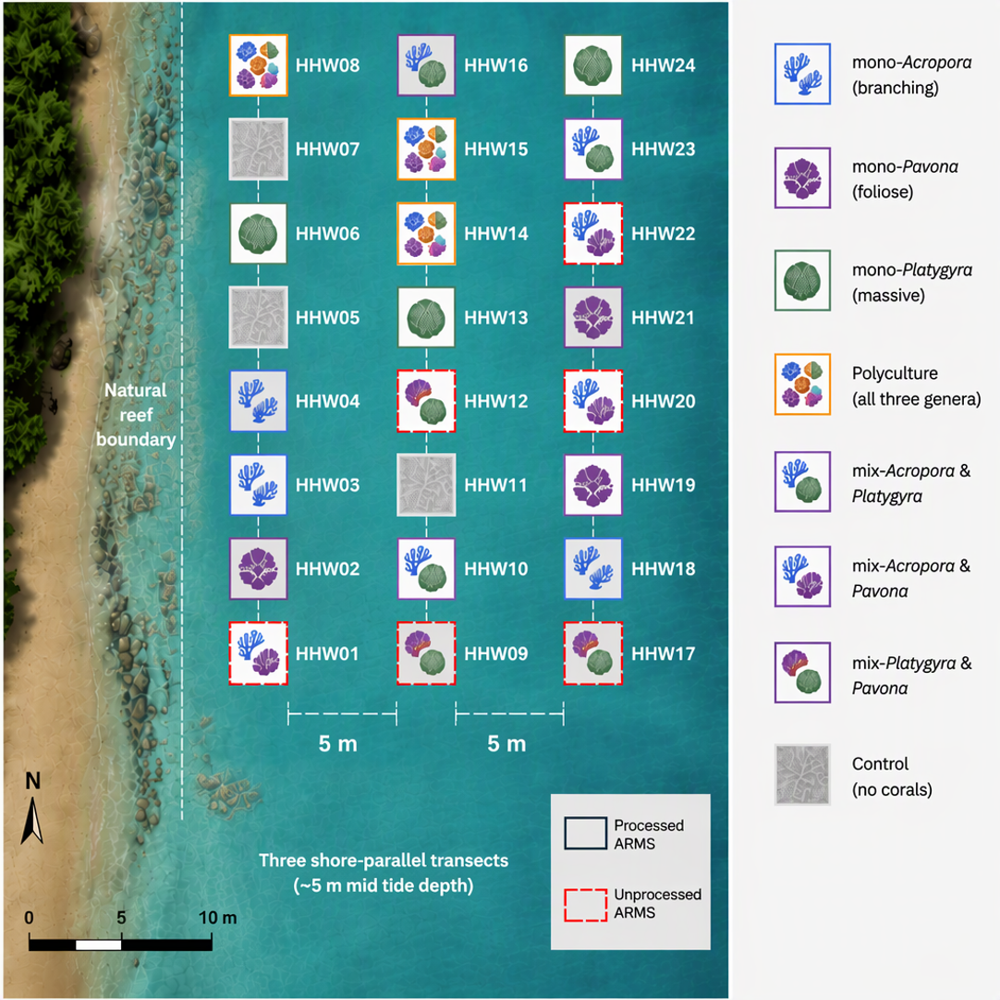

# Coral presence and reef proximity are associated with cryptobenthic community composition three years after restoration

#### author list hidden for double-anonymised review 

## Abstract 

 

Abstract \
Introduction \
Coral reef degradation has been recorded globally, and increasing efforts have been put into coral restoration, aiming to rebuild functional reef ecosystems. Polyculture—restoring multiple coral species together—has been identified as a promising strategy to promote coral growth and survivorship.

Objective \
This study aims to understand how different coral assemblages used in restoration effectively recruit the broader cryptobenthic community—the essential but often overlooked foundation of a functional reef.

Methods \
We used standardized Autonomous Reef Monitoring Structures (ARMS) and COI metabarcoding to compare cryptic biodiversity across a three-year restoration experiment in Hong Kong featuring different coral assemblages: monocultures (each consisting of a single genus: Acropora, Pavona, or Platygyra), a mixed-culture (two genera: Acropora + Platygyra), a polyculture (all three genera), and unseeded control plots.

Results \
Pooled OTU richness was descriptively, but not statistically, higher in coral-seeded restoration units than in controls, which showed a trend toward oyster-dominated, lower-diversity states. Ordination analyses revealed clear clustering of communities by distance to the healthy reef, consistent with distance-decay in community similarity over just 10 m. Ultimately, coral assemblage was significantly associated with cryptobenthic community composition, but pairwise differences between assemblages could not be resolved.

Conclusions \
Our results suggest that both restoration coral assemblage and proximity to an established reef were associated with benthic community recruitment patterns, though these effects were confounded in our experimental design.

Implications for Practice \
Habitat restoration should look beyond the survival and growth of the restored species and assess how they shape the ecological community. Leveraging ARMS and COI metabarcoding, we identified community patterns associated with coral assemblage and their distance to a mature reef. Yet over our three-year study period, the differences among coral assemblages were subtle, suggesting that the biodiversity benefits of coral restoration may require more time to fully materialize. Practitioners should therefore account for the effects of restoration species composition and spatial connectivity, and—most importantly—recognize that the full ecological outcomes of restoration may require decades, not years.

Keywords: coral restoration, ARMS, COI metabarcoding, community ecology.  

## Table of Contents

### Supporting Materials 
  1. [Code](1_code)
  2. [Data](2_data)
  3. [Figures](3_figures)
  4. [Tables](4_supplementaryTable.xlsx)

### Codes 
[1_rarefraction](1_code/1.0_rarification.R): data curation and read table and rarefaction \
[2_alphaDiversity](1_code/2.0_alpha_glmm.R): alpha diversity analysis for macrofauna & COI metabarcoding data. \
[3_multidimentional](1_code/3.0_multidimensionalAnalys.R): Multi dimensional analysis: PCoA/adonis/dbRDA. \
[4_read adbundance analysis](1_code/4.0_GLMMabundance.R): GLMM analysis on phylum-specific read abundance. \
[5_SIMPER_2mm](1_code/5.0_SIMPER.R): Similarity Percentages Analysis to identify taxa that contributed to significant community differences. (macrofuna data) \

### Data 
[meta data](2_data/1_sample-metadata.tsv): sample metadata. \
[feature table](2_data/2_feaTable.csv): feature table from COI metabarcoding showing all OTUs and their abundance in each ARMS. \
[taxAssign](2_data/3_TaxAsn.csv): taxonomic assignment results. \
[Abundance](2_data/4_motileData.csv): abundance data from motile macro fauna in each ARMS. \
[All seq](2_data/5_dna-sequences.fasta): all sequence data after the molecular pipeline. 

     
